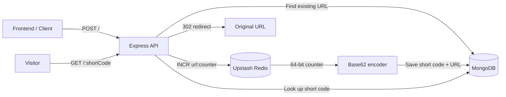

# Linkly Backend

<p align="center">
  
  
  
</p>

The backend for **Linkly**, a URL-shortening service that creates compact Base62 links and redirects visitors to their original destinations.

## Architecture



## Features

- Generates readable Base62 short codes from a Redis counter
- Uses Redis `INCR` for atomic, sequential counter increments
- Supports a 64-bit counter through JavaScript `BigInt` encoding
- Stores short codes and original URLs with MongoDB and Mongoose
- Returns an existing short link for a previously shortened URL
- Redirects `/:shortCode` requests to the original URL
- Includes JSON request parsing, CORS support, and environment-based configuration
- Starts the API only after MongoDB connects successfully
- Uses ES modules and a clean routes/controllers/models structure

## Tech Stack

| Technology | Purpose |
| --- | --- |
| Node.js + Express | HTTP server and routing |
| MongoDB Atlas + Mongoose | Persistent URL storage and schema modeling |
| Upstash Redis | Atomic counter storage |
| Base62 + BigInt | Compact, 64-bit-safe short-code generation |
| dotenv | Environment-variable loading |
| CORS | Frontend-to-backend browser access |

## API Reference

### Create a short URL

```http
POST /
Content-Type: application/json
```

```json
{
  "originalUrl": "https://example.com/very/long/url"
}
```

**Success response — `201 Created`**

```json
{
  "shortCode": "baaa",
  "originalUrl": "https://example.com/very/long/url",
  "shortUrl": "http://localhost:5000/baaa"
}
```

If the URL has already been shortened, the existing link is returned with `200 OK`.

### Redirect to the original URL

```http
GET /:shortCode
```

Example: `GET /baaa` redirects to the stored original URL. Invalid codes return `404 Not Found`.

## URL-Shortening Flow

1. The API validates that `originalUrl` was supplied.
2. MongoDB is checked for an existing record.
3. Redis atomically increments `url:counter`.
4. The numeric value is converted to a Base62 short code.
5. MongoDB stores the short code and original URL.
6. The API returns the complete shortened-link response.

## Getting Started

### 1. Install dependencies

```bash
npm install
```

### 2. Create `.env`

```env
PORT=5000
BACKEND_URL=http://localhost:5000
MONGODB_URI=your_mongodb_connection_string
UPSTASH_REDIS_REST_URL=your_upstash_redis_rest_url
UPSTASH_REDIS_REST_TOKEN=your_upstash_redis_rest_token
```

### 3. Start the server

```bash
npm start
```

The API runs at `http://localhost:5000` after MongoDB connects.

## Project Structure

```text
backend/
├── config/
│   └── redis.js                    # Upstash Redis client
├── controllers/
│   ├── createShortCode.js          # Creates or returns a short link
│   └── redirectToOriginalUrl.js    # Resolves and redirects short links
├── models/
│   └── Url.js                      # Mongoose URL schema
├── routes/
│   └── urlRoutes.js                # POST and redirect routes
├── utils/
│   └── base62.js                   # BigInt-safe Base62 encoder
└── index.js                        # App setup and database connection
```

## Author

**Akhilendra Ojha**

- [GitHub](https://github.com/code-bunnyy)
- [LinkedIn](https://www.linkedin.com/in/akhilendra-ojha-7b487a3b2/)
- [LeetCode](https://leetcode.com/u/ojha_akhil/)
